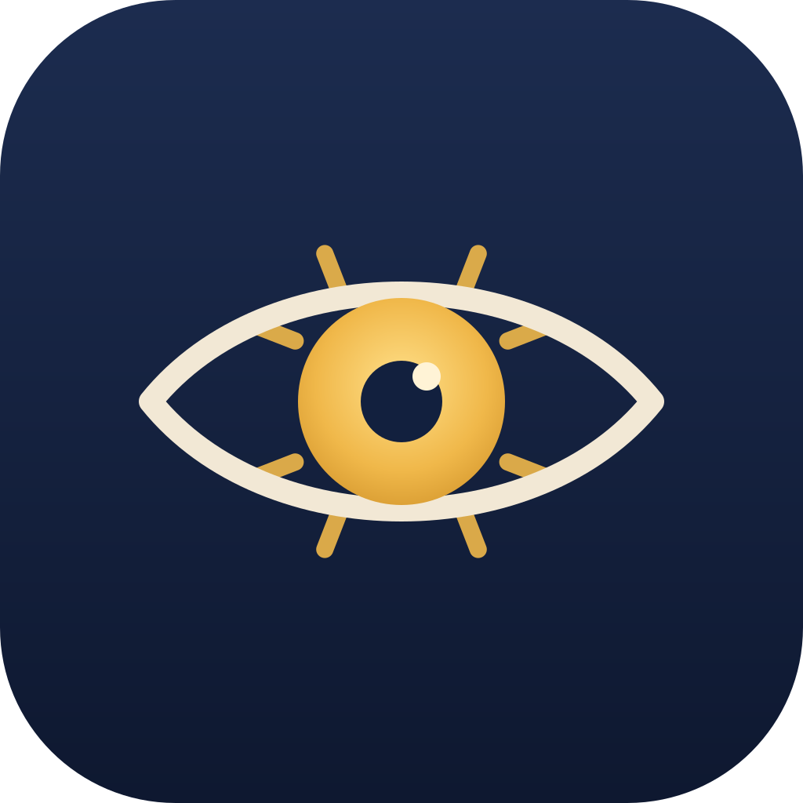

# Theia — the Eye of Aether

<p align="center">
  
</p>

In Greek myth, **Theia** is the Titaness of sight and shining light — she who gave
gold and gemstones their gleam, and mother of the Sun, the Moon, and the Dawn.
Fitting, then, that her eye watches over your markdown.

**Theia** is a markdown viewer and editor for Linux. Open a `.md` file and it reads
like a document. Press one key and you see the raw text beneath. She sees both.

## What she does

- **Reads beautifully** — clean typography, rendered headings, lists, tables and code, in light or dark
- **Edits plainly** — raw markdown in a calm editor, no chrome
- **The toggle** — `Ctrl+E` moves you between the sight and the source, scroll position carried across
- **Opens like water** — double-click any `.md` in your file manager, drag it onto the window, or `Ctrl+O`
- **Saves without ceremony** — `Ctrl+S`; if you try to leave with unsaved words, she asks first

## Install (Linux)

Two forms, same eye:

**Installed** — adds Theia to your applications menu and makes it the natural home of `.md` files:

```bash
sudo apt install ./Theia_0.1.0_amd64.deb
```

**Portable** — a single file you can carry anywhere:

```bash
chmod +x Theia_0.1.0_amd64.AppImage
./Theia_0.1.0_amd64.AppImage
```

Both live under `src-tauri/target/release/bundle/` after a build.

## Build from source

You need Node, npm, Rust, and the usual Tauri prerequisites
(`libwebkit2gtk-4.1-dev` and friends — see the [Tauri prerequisites](https://v2.tauri.app/start/prerequisites/)).

```bash
npm install
npm run tauri dev      # run in development
npm test               # markdown pipeline tests
npm run tauri build    # produce .deb, .rpm and .AppImage
```

## What she does not do

No tabs. No sidebars. No sync. Theia watches one file at a time —
the oldest and quietest way to see.

---

© 2026 — all rights reserved.
